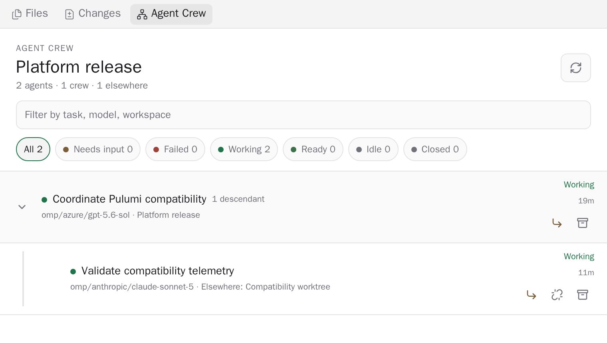
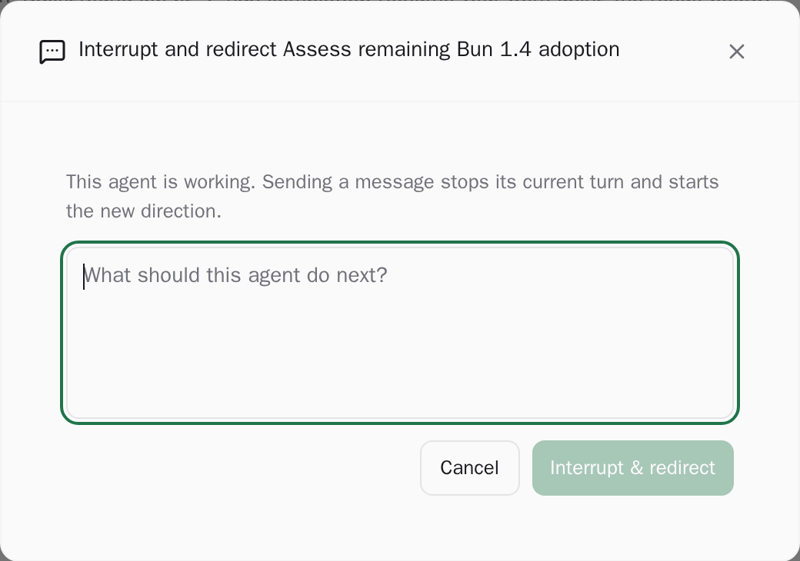

# paseo-agent-team

Define reusable Roles, compose them into Teams, and launch a cross-harness agent
crew from the Paseo UI. The plugin keeps the original Agent Crew Explorer panel
and adds Role / Team labels on agents this plugin creates.

Paseo Agent Profiles stay the execution config (provider, model, mode, thinking,
features). Roles own the identity, mission, restrictions, and **system prompt**.
Teams pick a coordinator Role plus members. Launch creates every member up front
with a real system prompt, parent relationship, and `agent-team.*` labels.

## Screenshots

Names, workspaces, and task details in these screenshots are synthetic. The rendered page was
rewritten before capture so no private project or session identifiers are published.

### Crew overview



### Safe action confirmation



## Install

Paseo plugins are trusted, unsandboxed code. Review the source before installing it.

From GitHub:

```bash
paseo plugin add Mason-x/paseo-agent-team:paseo-agent-team
```

From a local checkout on the Paseo daemon host:

```bash
git clone https://github.com/Mason-x/paseo-agent-team.git
cd paseo-agent-team/paseo-agent-team
npm ci
paseo plugin install "$PWD"
```

Open **Agent Teams** in the sidebar to create Roles and Teams. Open a workspace,
choose **New tab** in Explorer, then select **Agent Crew**. The **Open Agent Crew**
and **Launch agent team** Command Center actions open the panel directly.

## Configure

1. Create at least one Paseo Agent Profile per provider you want on a team
   (**Settings → Agents / Profiles**). Roles store Profile ids and optional binding hints.
2. Open **Agent Teams → Roles**. Create a Role or import the 22 default Role presets
   when the catalog is empty. The presets do not include Teams.
3. Bind each Role to a preferred Profile (and optional fallbacks). Missing
   Profiles are marked; they are never silently replaced.
4. Open **Teams**. Choose a coordinator Role and at least one member Role.
   Duplicate Roles need an `instanceLabel` (for example Backend / Frontend).

The first import into a new, empty catalog uses the default Role presets. **同步默认预设**
previews additions and field differences: missing presets are selected by default; changed
Roles and previously deleted presets are kept unless you explicitly select them. Adopting a
preset preserves its creation time and rebinds its Profiles using the current host.

Binding requires a normalized name and identical provider/model/mode/thinking settings, or a
unique runtime match when there is no same-name Profile. Ambiguous, changed, or missing
Profiles stay unbound; preferred and fallback order is preserved. A Profile read failure blocks
automatic import; manual import can explicitly leave all references unbound. Bind those in the
Role editor before launch. Presets contain no host Profile ids or Profile notes.

The bundled Ruflo catalog has been removed; previously imported Roles and Teams remain in your
host settings. Downgrading to an older plugin can discard binding hints, preset origins, and sync
history on subsequent saves, but existing Profile ids still work. Damaged preset origins, Profile
hints, or sync history are ignored rather than invalidating the catalog.

## Launch

From a workspace: **Agent Crew → Launch team**, the Command Center action **Launch agent
team**, or the slash command `/team [team] <task>`. From **Agent Teams → Teams**, use a team's
**Launch** button and pick an existing workspace or a project to cut a new worktree from.
From a terminal:

```bash
npm run launch:team -- --host 127.0.0.1:6767 --team coding-team   --workspace <workspaceId> "Add Stripe billing"
```

Preview shows the resolved Profile and source (member override, preferred, or fallback) plus
warnings and blockers. Launch is disabled while blockers remain. Blockers include a coordinator
whose provider cannot reach Paseo's delegation tools (Paseo MCP off, "Inject Paseo tools" off,
or the provider's "Enable Paseo tools" off).

After confirm, the daemon host re-validates, creates the coordinator, then each member as a
child, then sends the coordinator a kickoff message with the roster. The launch runs on the
host: closing the dialog or the client does not interrupt it. Members stay idle until the
coordinator uses `send_agent_prompt`.

## Follow progress

**Agent Teams → 运行** lists every run on the host across workspaces; the Crew panel shows the
same per run. Each run has a phase (starting, running, needs you, done, failed), per-member
state (waiting, working, delivered, needs permission, failed), the coordinator's todo list as
the plan, and each member's current task and latest report. Open **进度** for the detail, or
**追加任务** to send new work to the coordinator.

Progress is derived only from agent state, labels, and timelines, so it works for every provider
and nothing is stored by the plugin. The coordinator is told to keep a todo list; a provider
that has no todo tool simply shows member delivery instead of a plan bar.

If the coordinator asks for a permission, the Crew panel offers **Allow, don't ask again this
session** next to Allow / Deny. It retargets the provider's suggested rule to the running session,
so nothing is written to disk.

## Limits

- Requires Paseo `>=0.12.0` (checked on 0.12.0 and 0.13.0-beta.1). Only the public plugin SDK is used. The manifest schema accepts
  `id`, `name`, `description`, `icon`, `media`, `requirements`, and `build`.
- Roles and Teams are host-scoped settings. Every client on that daemon shares them. There is
  no per-workspace catalog.
- Default member cap is 8 (hard cap 16). Members are created up front.
- A coordinator's `create_agent` cannot set `systemPrompt` or pick a Profile. This plugin
  therefore pre-creates members instead of letting the coordinator spawn them.
- Put limits in Role restrictions text. Coordinators are told never to call
  `respond_to_permission`.
- Native provider subagents are not shown in Crew Tree.
- Sending to a running member steers into its turn, or interrupts it when the provider cannot
  steer.
- Every member is a subagent of its coordinator, so Paseo forwards its final reply to the
  coordinator by itself. A coordinator provider must permit `mcp__paseo__send_agent_prompt`
  unattended, or each delegation waits for a human to approve it. Use the Crew panel's
  session-scoped allow, or a provider mode that auto-approves.

## Compatibility

`paseo-plugin.json` declares `requirements.paseo`. Paseo refuses to load the plugin on an
older host with a message naming the range. The plugin is built so a Paseo upgrade is a small
change:

- `shared/paseo/port.ts` is the whole Paseo client surface the plugin calls. A change in
  Paseo breaks the typecheck at that one file.
- Settings, RPC contracts, and labels carry versions or fixed names: `agent-team-*` settings,
  `agent-team.*` RPCs and labels. Do not rename them.
- Reads of daemon-owned shapes (config, timelines) skip what they do not recognise and never
  block a launch on something unfamiliar.
- UI imports come from `@getpaseo/plugin/client/react-native`, the one entry that exists on both
  0.12 and 0.13. Paseo 0.13 keeps it as a deprecated alias and plans to drop it after 2027-04-20;
  move to `client/ui` when the minimum becomes 0.13. `SidebarRow` is the exception: it is only
  in `client/ui`, on both versions.

Before upgrading, run against the new SDK:

```bash
npm run typecheck:beta   # typecheck against @getpaseo/*@beta
npm run verify:package   # compile with the Paseo host's own plugin compiler
```

`verify:package` loads both bundles through the compiler the daemon uses on load and checks
the manifest and every registration, so boundary errors surface before a restart.

## Crew Tree

The Explorer panel is the original Agent Crew UI:

- Every non-archived managed agent in the current workspace, organized into
  orchestration trees, including managed descendants in other workspaces.
- Status filters, search, Nudge, Redirect, Detach, Archive, and explicit
  permission Allow / Deny.
- Agents launched by this plugin also show `{role} · {team}` from labels, even
  if the Role definition was later deleted.

Ordinary Paseo agents that this plugin did not create are unchanged.

## Develop

Follow `AGENTS.md`. Never point plugin lifecycle commands at the default Paseo home.

```bash
npm ci
npm run check
npm test
npm run test:coverage
npm run typecheck
npm run verify:package
```

The project pins `@getpaseo/cli`, `@getpaseo/client`, `@getpaseo/plugin`, and
`@getpaseo/protocol` to the Paseo version it is verified against (currently `0.13.0-beta.1`).
React 19.2 and React Native 0.86 match that host (0.12 expects React 19.1 and React Native 0.81).

Layout: `client/` runs in the app, `server/` in the daemon's plugin process, `shared/` in both
(no React, no Node, no `@getpaseo/client` imports).

See `UPSTREAM.md` for the Agent Crew import commit.

Release Please maintains versions, changelog entries, component tags, and GitHub
releases from Conventional Commits.
