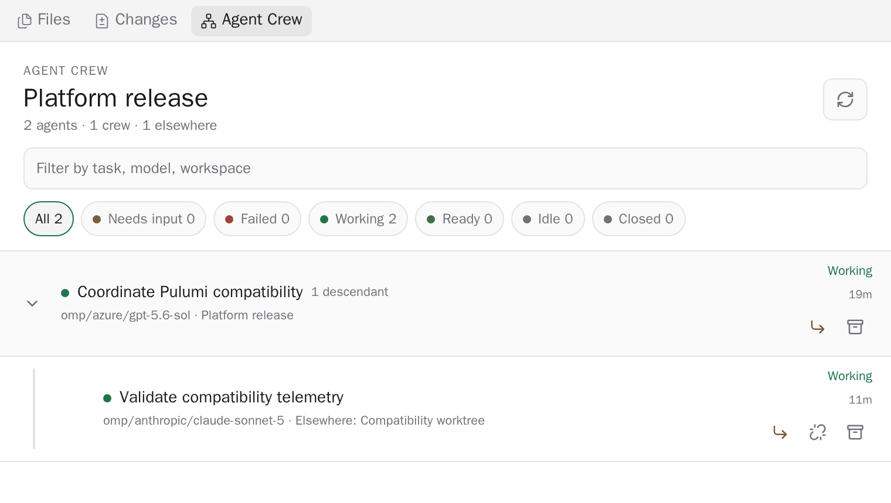
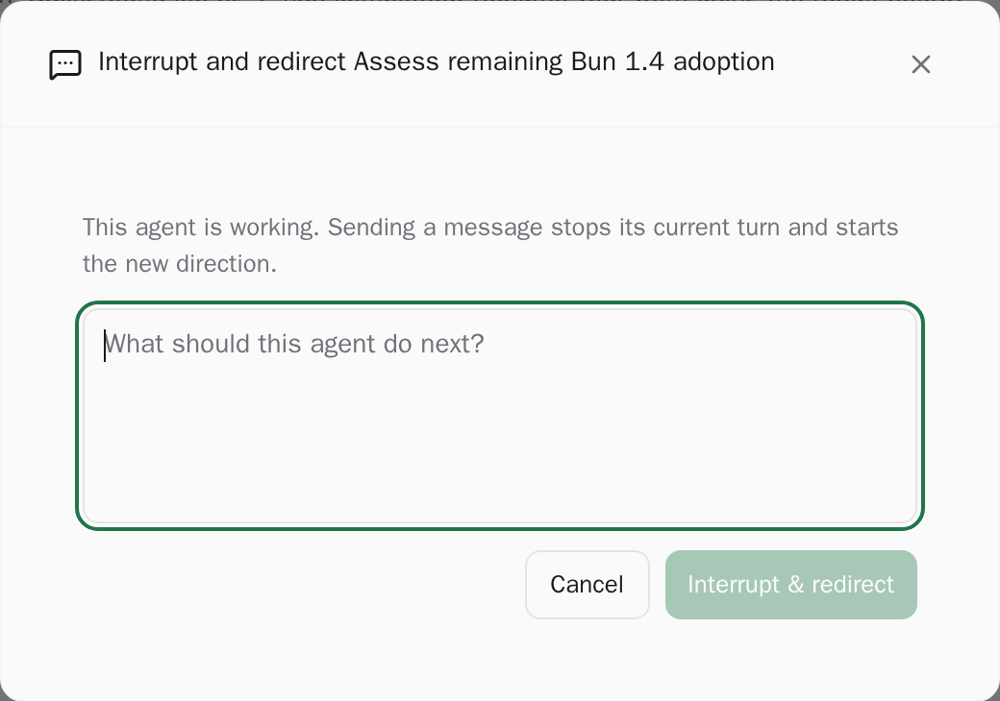

# paseo-agent-team

Define reusable Roles, compose them into Teams, and launch a cross-harness agent
crew from the Paseo UI. The plugin keeps the original Agent Crew Explorer panel
and adds Role / Team labels on agents this plugin creates.

Paseo Agent Profiles stay the execution config (provider, model, mode, thinking,
features). Roles own the identity, mission, restrictions, and **system prompt**.
Teams pick a coordinator Role plus members. Launch creates every member up front
with a real system prompt, parent relationship, and `agent-team.*` labels.

## Screenshots

Names, workspaces, and task details in these screenshots are synthetic. The rendered page was
rewritten before capture so no private project or session identifiers are published.

### Crew overview



### Safe action confirmation



## Install

Paseo plugins are trusted, unsandboxed code. Review the source before installing it.

From GitHub:

```bash
paseo plugin add Mason-x/paseo-agent-team:paseo-agent-team
```

From a local checkout on the Paseo daemon host:

```bash
git clone https://github.com/Mason-x/paseo-agent-team.git
cd paseo-agent-team/paseo-agent-team
npm ci
paseo plugin install "$PWD"
```

Open **Agent Teams** in the sidebar to create Roles and Teams. Open a workspace,
choose **New tab** in Explorer, then select **Agent Crew**. The **Open Agent Crew**
and **Launch agent team** Command Center actions open the panel directly.

## Configure

1. Create at least one Paseo Agent Profile per provider you want on a team
   (**Settings → Agents / Profiles**). Roles store Profile ids and optional binding hints.
2. Open **Agent Teams → Roles**. Create a Role or import the 15 default Role presets
   when the catalog is empty. The presets do not include Teams.
3. Bind each Role to a preferred Profile (and optional fallbacks). Missing
   Profiles are marked; they are never silently replaced.
4. Open **Teams**. Choose a coordinator Role and at least one member Role.
   Duplicate Roles need an `instanceLabel` (for example Backend / Frontend).

The first import into a new, empty catalog uses the default Role presets. **同步默认预设**
previews additions and field differences: missing presets are selected by default; changed
Roles and previously deleted presets are kept unless you explicitly select them. Adopting a
preset preserves its creation time and rebinds its Profiles using the current host.

The presets bind only to the host's current Profiles, one job per model:

| Profile | Preset Roles |
| --- | --- |
| Claude-Opus-5.5-Max | 【规划】架构师 (project planning and architecture; writes no code) |
| Claude-Sonnet 5.5 high | 【统筹】主负责人, 【统筹】总协调, 【统筹】技术负责人 |
| GPT-6.1-Sol Xhigh | 【工程】排障修复; fallback for 主负责人 |
| GPT-6.1 Terra Max | 【工程】主力开发 (all-round main developer; fallback Claude-Sonnet 5.5 high) |
| DeepSeek-V4.1-Flash-Max | 【工程】全栈开发, 【工程】前端开发, 【工程】批量开发, 【研究】代码库分析师, 【质量】测试与验收 |
| Grok-4.6-Xhigh | 【质量】代码审查, 【研究】联网研究员 |
| Gemini-3.8-flash-High | 【研究】资料与视觉解析, 【内容】写作与翻译 (OCR, charts, Q&A, summaries, translation, drafts) |

Roles have ordered fallbacks. The `default` designer recipe uses 主负责人 as coordinator with 全栈开发,
代码库分析师, 测试与验收, and 代码审查 enabled. 排障修复 and 架构师 are optional specialists;
they are not enabled by default because enabled members are created immediately. The 2026-10-28 catalog merged or dropped
the earlier research and content leads, requirements analyst, rapid, ops, security, acceptance,
vision and the three content Roles. Roles already imported from those presets stay in your
catalog; **同步默认预设** leaves them untouched and never deletes them.

Binding is by Profile name: a normalized name that matches exactly one Profile binds, whatever its
provider/model/mode/thinking settings are, so editing a Profile in Paseo never unbinds a Role. The
settings in a preset only pick between Profiles that share a name, or find a renamed Profile when
exactly one Profile has the same settings. Ambiguous or missing
Profiles stay unbound; preferred and fallback order is preserved. A Profile read failure blocks
automatic import; manual import can explicitly leave all references unbound. Bind those in the
Role editor before launch. Presets contain no host Profile ids or Profile notes.

The bundled Ruflo catalog has been removed; previously imported Roles and Teams remain in your
host settings. Downgrading to an older plugin can discard binding hints, preset origins, and sync
history on subsequent saves, but existing Profile ids still work. Damaged preset origins, Profile
hints, or sync history are ignored rather than invalidating the catalog.

## Team planning and older settings

The four Team modes and economy pool have been retired. Each seat now resolves its Role's preferred
Profile followed by its fallback Profiles. Existing mode, collaboration, pool, and Role execution
policy settings still decode but do not affect planning. When an object is next saved, those retired
keys are removed only if the target host confirms support; an older host or a failed probe preserves
them. Other settings, including quota recovery and unknown extensions, are retained.

Removing these keys is irreversible on downgrade: a previously saved Team defaults to the old
flagship path, and removed pool, collaboration, and Role policy settings must be recreated manually.
An unsaved old all-seats Team may be blocked by an older host if its pool was already removed.
The designer's "existing Roles only" switch remains a per-request choice.

## Launch

From a workspace: **Agent Crew → Launch team**, the Command Center action **Launch agent
team**, or the slash command `/team [team] <task>`. From **Agent Teams → Teams**, use a team's
**Launch** button and pick an existing workspace or a project to cut a new worktree from.
From a terminal:

```bash
npm run launch:team -- --host 127.0.0.1:6767 --team coding-team   --workspace <workspaceId> "Add Stripe billing"
```

Preview shows the resolved Profile and source (member override, preferred, or fallback) plus
warnings and blockers. Launch is disabled while blockers remain. Blockers include a coordinator
whose provider cannot reach Paseo's delegation tools (Paseo MCP off, "Inject Paseo tools" off,
or the provider's "Enable Paseo tools" off).

The terminal client accepts no `--mode` or `--mode sota`; any other value is rejected before
connecting to the host. Refresh an old page or update an old CLI if it requests a retired mode.

After confirm, the daemon host re-validates, creates the coordinator, then each member as a
child, then sends the coordinator a kickoff message with the roster. The launch runs on the
host: closing the dialog or the client does not interrupt it. Members stay idle until the
coordinator uses `send_agent_prompt`.

## Follow progress

**Agent Teams → 运行** lists every run on the host across workspaces; the Crew panel shows the
same per run. Each run has a phase (starting, running, needs you, done, failed), per-member
state (waiting, working, delivered, needs permission, failed), the coordinator's todo list as
the plan, and each member's current task and latest report. Open **进度** for the detail, or
**追加任务** to send new work to the coordinator.

Progress is derived only from agent state, labels, and timelines, so it works for every provider
and nothing is stored by the plugin. The coordinator is told to keep a todo list; a provider
that has no todo tool simply shows member delivery instead of a plan bar.

If the coordinator asks for a permission, the Crew panel offers **Allow, don't ask again this
session** next to Allow / Deny. It retargets the provider's suggested rule to the running session,
so nothing is written to disk.

## Run Engine (opt-in)

By default a launched Team runs on the coordinator chain described above: the coordinator decides
who works on what. The Run Engine is a second way to run a Team that is off unless you turn it on.
The coordinator only writes the task graph; the Engine itself (plain code, no model of its own)
dispatches each task to a member seat, takes the member's report, checks the evidence, asks an
independent reviewer (and a DEV smoke where the task declares one), sends back what failed, and
stops at a decision for a person when it will not undo something by itself.

**Turn it on.** Two things, both required:

1. Start the daemon with `PASEO_AGENT_TEAM_RUN_ENGINE=1`. Without it a Team that has the Engine
   enabled is refused at launch with a message; it never falls back to the coordinator chain
   silently.
2. In **Agent Teams → Teams**, edit the Team and open **Run 引擎**: switch it on, give each seat a
   tier (S, A, B), its duties (implement, review, smoke) and its channel (normally its Profile's
   provider, for example `claude`), and check the policy numbers. The launch preview shows what
   would be refused or warned about before you start (a seat missing for a member, no independent
   reviewer at the tier a task needs, a Codex Profile that is not full-access).

The Workspace must be a git repository on a branch with a clean tree and a usable committer
identity: members commit their work there, and the evidence is written outside the repository
(`<PASEO_HOME>/agent-team-evidence/<runId>` when the evidence root is `auto`).

**What it does.** One Run is one ledger file. Every message to a member goes through an outbox: the
intent is written first, sent once, and a result that is not known is checked against the member's
timeline and never sent twice. A report that is missing or malformed is asked for again a bounded
number of times; evidence the gate refuses is asked for again on the same delivery; a host read
that failed is read again 1, 2 and 4 seconds later; once the read works again the Engine takes in
what it missed and goes on by itself, for each source at most 3 times, after which a note asks you to
press 立即检查并推进. A paused, finished or
cancelled Run sends nothing new. So does a Run with more failed tasks than its policy allows (the
Team's 允许失败的任务数, 3 by default, frozen when the Run starts; a cancelled or blocked task is not a
failed one): no task that has not started yet is started and a critical alert says so, while work
already under way (reports, repairs, reviews, smoke runs, supplements, reworks) goes on and is
finished. Retry or cancel the failed tasks at their decision to bring the count
back within the limit; the alert is taken down by itself.

**What it does not do.** It never answers a permission request for an agent: a task whose agent
waits for permission stays waiting until a person answers in Paseo, as for any agent. It does not
approve from the Runs page, it cannot cancel one task while a member is still working on it (a
cancel waits for the turn to end), it cannot hand a task to another seat, it does not retry a
transient failure after a message was dispatched by itself, and it cannot resume a launch that was
interrupted while members were being created. A Run holds at most 8192 events: old history is folded
into a summary (it cannot be expanded again), and when the ledger nears a limit it stops starting
new work and says so, so a very long Run is finished and restarted rather than overfilled.
Acceptance status per scenario is in `docs/run-engine-acceptance.md` in the repository; the
decisions on what is left out, and why, are in `docs/next-phase-plan.md`.

**Closing or archiving a member's Agent while a Run is live.** If Paseo closes or archives a member's
Agent in the middle of its turn, the host may never report that the turn ended. The Engine notices
(it saw the Agent closed, or reads it as closed with no turn running) and records the turn as ended
itself. When the host reported the turn's end first, the lost-reply rules under *Recover and roll back*
apply instead: an `archived` receipt gives a cancel-only decision, while a producer or reviewer that is
idle after a graceful daemon stop with only a `closed` receipt gets a `host-lost` decision with retry
or cancel. When the Engine recorded a closed turn itself, what the person is offered depends on whether the member
can be reopened: a producer's or reviewer's turn whose member is only closed is first given a look at
reopening (see *A member that is only closed* below) and gets a `host-lost` decision (retry or cancel) when
the member reopens; a member that cannot be reopened or was archived, a smoke tester, a supplement, the
coordinator and a paused Run get a `member-lost` decision, a
decision that can only be answered with cancel: that member is not asked again. Whatever the cut-off
turn replied is not taken in (even a valid report), and the
Engine sends nothing to the member and archives nothing. Answering cancel releases the task's claims
and cancels the tasks that depend on it; cancelling the whole Run finishes as well. An archived
member's seat takes no more work in this Run, so a task that needs that seat can only wait or be
cancelled with the whole Run (one task cannot be cancelled alone yet).
**Do not archive the coordinator while a Run is live: archiving it archives the members it created.**
Going back to 0.6.x: a member-lost decision that
nobody answered shows a retry there; do not pick it. While the Agent stays closed the seat refuses
the new attempt and nothing is sent (for a reviewer's decision the retry is refused outright), but
it is misleading; cancel instead.

**A member that is only closed.** A daemon restart or a kill leaves every member closed, and reading its
history opens it again. So when the member of a producer's task turn or of a reviewer's turn is only
closed (a `closed` receipt, or the host reads it as closed, with no `turn_ended` and no `archived`
receipt), the Engine does not call the turn lost at once. The first look that sees it reads the member's
history once to try to reopen it (read only: no message, no model call, 30 seconds at most) and raises a
warning that says what it waits for and when to press **立即检查并推进**. A read that failed is not
repeated by the automatic looks; each press of the button allows exactly one more. The first look at
least 30 seconds after the member was first seen closed settles the turn (the time of the `closed`
receipt, else the first look, which is kept in memory only: after a plugin restart the 30 seconds start
again, so it is later, never earlier; nothing runs by timer). If the member then reads idle with no turn
running, the Engine writes its own turn end (`outcome` `host-lost`), opens a `host-lost` decision (retry
or cancel) and takes the warning down in the same commit. If it is still closed, cannot be read or does
not open, the turn is `member-lost` (cancel only) as before and the task note keeps the host's own error
text. A member with a turn running at that moment (someone wrote to it) is left alone and the warning
stays; so is a look that cannot read the member (the warning stays, nothing is timed or settled, the wait
goes on when it can be read). An `archived` receipt, a member the host no longer has, a smoke tester, a
supplement, the coordinator, a Run that is being cancelled and a Run that is paused keep the earlier rule:
lost at once (a paused Run reads no history and waits for nothing). Before you answer retry, look at the member's
branch and clean up what the cut-off turn left behind; the Engine sends the new task only after your
answer. The text of the `host-lost` decision names both causes: the dispatch is gone from the member's history, or the member was closed and reads idle after being reopened. Two cases stay: a reopened member can read idle without being usable (a Claude member cut off in
the first seconds of its first turn), and then the retried turn fails through the ordinary failure path
and you can cancel; a Codex member that never ran a turn cannot be opened and can only be cancelled.
While the turn waits, the host reads of that member are held back by a mark kept in memory, not in the
ledger, so a plugin restart loses the mark and the wait starts again from the first look.
Going back to 0.7.x: a `host-lost` decision of this kind (a producer's or reviewer's turn whose member was only closed) answered with retry is accepted and the task goes back to ready, but 0.7.x does not reopen a closed seat, so the new attempt stops at the closed seat and nothing is sent; answer cancel instead. A 0.7.1 drill read the v1 and v2 ledgers this writes (parse, invariants and the decision's `retry` and `cancel` all work; the settled turn end is an ordinary receipt with extra fields that 0.7.1 ignores); the stop at the closed seat is 0.7.x's own seat-closed refusal and was not rehearsed on a live 0.7.1 host. Answer these decisions before rolling back.

**Advanced fields.** Two policy fields have no control in the Team editor. They live in the Team's
`runEngine` block under `policy` (Teams are stored in the host setting `agent-team-teams`), and the
editor keeps them as they are when it saves, as it does every field it does not know (an excerpt:
the block also holds `version`, `enabled`, `seats` and the other `policy` fields the editor wrote):

```json
{
  "runEngine": {
    "policy": {
      "devTargets": [{ "serverId": "dev-1", "host": "127.0.0.1:6799", "home": "D:/dev/paseo-home" }],
      "evidenceRoot": "auto"
    }
  }
}
```

- `devTargets` (at most 16 entries of `serverId`, `host`, `home`) registers the DEV Paseo instances a
  task's smoke check may run against. `host` needs an explicit port other than 6767 and no
  credentials; `home` must not be a `.paseo` directory. A task graph that declares a smoke check
  while no entry has a usable `host` is refused. Leave it empty if no task needs a smoke check.
- `evidenceRoot` is `"auto"` (the default: `<PASEO_HOME>/agent-team-evidence/<runId>`) or an
  absolute directory outside the repository, which is created when missing. Members write their
  evidence there, and the quality gate only accepts reported paths under it.

**Follow and steer a Run.** **Agent Teams → 运行 → Engine 运行** lists the Runs and opens one: the
task graph, each task with why it waits, who clears it and what happens next, locks, budgets,
decisions, channels and alerts, and a history with the cause of each event. These controls appear
only when the Run offers them:

- **重新规划** (re-plan), while the Run waits for a task graph: asks the coordinator again, with a
  reason you write. It takes one turn from the coordinator's turn budget (see 追加预算).
- **重试** (retry) on a decision the Engine opened for a stopped task (D1, D3, D4): after you
  confirm, the task gets one more attempt from where it stopped. Nothing is released until every
  turn of the task is proven ended.
- **取消任务** (cancel a task), on the same decisions: the task and every task that depends on it are
  cancelled and their claims released, once every turn of the task is proven ended. Nothing is sent to
  a member and nothing is rolled back: what was committed stays on the branch, revert it yourself if
  you do not want it. A decision for a task stopped by a member's answer to an evidence request offers
  only this, because a retry would throw the delivery away.
- **立即检查并推进** (kick): reads the host, takes in reports that were missed, sends what was
  prepared and not yet sent, and moves the Run on. It completes no task for a member.
- **暂停派发** (pause), while the Run is running: nothing new is dispatched and no new message goes
  to a member. Turns already running go on to their end and a report that arrives is taken in as
  usual.
- **继续** (resume), while the Run is paused: reads the host, takes in what arrived meanwhile, sends
  what was held back once, and dispatches again.
- **追加预算** (add turns), on a seat of the Run: a seat's turn budget is a limit, and a task that
  needs a seat whose turns ran out waits with a warning that says so. Adding 1 to 64 turns (1024 in
  all) lets what was held back go on; the Run's frozen policy is not changed, the new limit is
  recorded on the Run. The coordinator has a row of its own, with the Team's 协调者回合数上限
  (12 by default, at least 1 to start a Run): the plan request and each re-plan take one turn, a
  format re-send of the plan does not, and no turn is given back. A re-plan with no turn left is
  refused with a warning; add turns to the coordinator's row and ask again.
- **取消这个 Run** (cancel the Run), with a reason you write: nothing new is dispatched from then on
  (the Run is paused and cannot be resumed), and once every turn that was running is proven ended on
  the host's own record, every unfinished task is cancelled and every claim released. It sends no
  message, archives nothing and interrupts nothing, so it costs no model call; it does not roll back
  code. A long running turn is waited for, and a delivery whose result is not known keeps it waiting
  (the page says what for; **立即检查并推进** looks again). A Run that is still being set up cannot be
  cancelled yet; one that has no task yet is cancelled at once.

A refusal is shown in words; if the Run changed since you looked, the page reads it again and asks
you to try once more. A request is never applied twice. What you type into a reason box (and the
number in 追加预算, and an open confirmation) stays while the page keeps polling; stopping the
daemon unloads the whole panel and reloading the page clears them, so a draft does not survive a
daemon restart.

**Recover and roll back.**

- After a restart the daemon recovers every live Run from its ledger and works out again which
  reads and sends are due. The plugin gets no Paseo handle when it loads: recovery starts with the
  first RPC or hook it receives after the daemon is up, so after restarting the daemon **open the
  Runs page** (any call counts, and the page makes one as soon as it loads) for the Engine to
  start; until then a live Run does not move. One case needs a person: a Run whose launch was interrupted while its
  members were being created cannot be resumed. It is closed with a critical alert that lists the
  Agents already recorded for it (it may be missing ones that were created but not recorded, the
  coordinator is created first). Look for those Agents in Paseo, archive them if you do not want
  them, and start the Run again; nothing is archived for you.
- New Runs are written as ledger schema v2; this version reads v1 and v2. A Run written as v1 is
  not migrated and is not given evidence supplements. An older plugin version cannot read a v2
  Run: it keeps the file untouched, and because it then cannot see which files that Run holds it
  refuses to grant new write claims to any Run, in any repository. Do not roll back while an
  Engine Run is live.
- If a member answers an evidence request with "blocked" or "failed", the task stays frozen with
  its claims and a decision is opened that offers only 取消任务 (there is no Retry, because a retry
  would throw the delivery away). Look at the member's conversation, then cancel the task or leave
  it frozen; re-assigning is not in the page yet.
- A host restart loses the turn a member was in the middle of. The Engine reads the member's reply
  three times, then leaves a warning that says the tries are used up (`incomplete:dispatch-not-found`).
  For a producer's own task turn or a reviewer's turn, wait at least 30 seconds after that, then press
  **立即检查并推进**: if the member is idle in Paseo and the dispatch is still not in its history, the
  Engine records the turn as lost by the host (a turn end it writes itself, with `outcome` `host-lost`),
  takes the warning down and opens a decision that you answer with retry or cancel. Retrying a producer
  starts a new attempt. Retrying a reviewer closes that review and sends one new review, with the usual
  budget reservation; the producer's delivery, evidence, claims, attempt and quality counters stay as
  they were. Cancel releases the task's claims and cancels what depends on it, and cancelling the whole
  Run finishes as well. Nothing runs by timer: the look happens when you press the button, when a hook
  arrives or when the daemon recovers, and the Engine sends the member nothing by itself. After a host
  restart the member's provider process may still be running (on Windows too): make sure it has
  stopped before you answer. A member the host reads as closed is the closed-or-archived case above (a producer or reviewer that is only closed: *A member that is only closed*).
  Where the host never reported the turn's end, the Engine settles only a producer's or reviewer's turn.
  It does not settle a smoke tester, a supplement or a re-report, or a turn it never saw begin (no
  turn start on record): for those the warning is still shown, the Run does not move on, a kick
  sends nothing and writes nothing, and cancelling the whole Run keeps waiting for a turn end the
  host never reports. There is no such warning for a Run written as v1: it has no record of the
  re-checks and shows none at all; this description is the only place its way out is written down.
  The way out is yours: wait until the member is idle in Paseo, send it one message that
  asks only for a reply of OK, wait for its answer, then press **立即检查并推进**. The member's
  own turn then reaches the Engine as the host's record and lets the cancellation
  finish; it is not certain to recover the Run. **继续** (resume) is no way out; if the member
  does not answer, cancel and start the Run again. If you cancel the whole Run while a settled turn
  waits, the turn is still recorded (that lets the cancellation finish) but no decision is opened:
  the Run is cancelled and nothing is left to answer.
  **A reply the host lost after it said the turn ended.** The host often reports the turn's end first and
  loses the turn afterwards: closing or archiving the member (also with `--force`, or by archiving its
  coordinator) and stopping the daemon each sent a turn end before the turn was lost, in all three DEV
  tries. The reply then cannot be read, the warning of the used-up tries shows, and there is no turn end
  left for the Engine to write. After the same 30 seconds, pressing **立即检查并推进** (or a hook, or a
  recovery) opens the decision when all of this holds: the task still waits for its report and its
  dispatch was delivered, and no message to the member or for the task is on its way or of unknown fate;
  the host's own record says the turn ended (the newest turn end of the member after the task was sent,
  the task's own turn when it has one, and no turn started after it; the newest end tells whether the
  member has gone quiet, while the turn an assignment ran in is still the bound or earliest appearance,
  see the next item) and a read of the member shows it idle or closed with no turn running. That is the proof the
  cancellation of a Run takes, with one difference: the cancellation also counts a member the host says
  it has no Agent for as quiet, this settlement does not, so if the host answers that way (or the read
  fails) for an archived member nothing opens here and the warning stays; check what the host really
  answers when you try a forced archive on DEV. The
  tries were used up with exactly `incomplete:dispatch-not-found` and one more look, made at least 30
  seconds after the last failure, still finds the dispatch missing. It writes no receipt, no release, no message:
  only the decision, the task's note of why it waits and the warning coming down are recorded. The
  decision is `member-lost` (cancel only) when the read of the member says closed now, or when the host
  archived it after the task was sent (an `archived` receipt). A `closed` receipt alone does not count: a
  graceful stop of the daemon writes one for every agent, and after the restart the member is idle and
  can be asked again (DEV, T9v). So a producer's own task turn or a reviewer's turn gets `host-lost`
  (retry or cancel) whatever closed receipts there are. A smoke tester or supplement still gets
  `member-lost` when a closed or archived receipt came after the task was sent or the read says closed
  now, and no decision otherwise. A host-lost decision is cut to cancel only when the
  member is archived after it was opened; a closed receipt does not do that. One case is worse than it
  was: if the archived hook of a member was lost and a graceful stop then wrote a `closed` receipt, the archived member reads as idle, the decision is `host-lost`, and retry sends the task to an Agent that is archived (the seat read carries no archived flag, and the dispatch does not refuse it). It is rare; before you retry, make sure the member was not archived. The decision says that the reply is lost, that the member may have done part of
  the work, and asks you to look at its branch and to make sure its process has stopped first (a turn end
  does not prove that: on DEV the member's process kept writing for about 20 seconds after a graceful
  stop). Once the decision is open, the reply of this attempt is never taken in, even if it can be read
  later. Any other reason (a reply that is too large, a failed read, an unreadable window, another
  incomplete reading), a member that is still running, a turn started after the end, or a delivery that is
  not settled opens nothing and leaves the warning. A smoke tester or supplement only ever gets
  `member-lost`. While the whole Run is being cancelled nothing is opened: the cancellation takes the
  host's own end as it is.
  Going back to 0.6.x: a host-lost decision is an ordinary retry-or-cancel decision there, and the
  Engine's turn end reads as the host's. The settlement itself sends nothing; answering retry sends
  the member one message there as it does now. Going back to 0.7.0 (not rehearsed; from its
  source): a member-lost decision could only be cancelled there already; the retry of a host-lost
  decision may still send the member a message if the reply stays unreadable, and 0.7.0 has no gate that
  holds back a reply that becomes readable later, so if one does, it is taken in and the retry on the
  decision no longer does anything. Do not roll back while a Run is live (see above).
  A 0.7.1 rollback drill used a real v2 review `host-lost` decision: 0.7.1 showed retry but rejected it
  as `decision-stale`. Answer such decisions before rolling back to 0.7.1.
- **A host restart while the coordinator is planning.** The plan is the coordinator's reply to the
  plan request, and a restart can lose it. When the coordinator's plan request is no longer in its history
  (`incomplete:dispatch-not-found`), the host reported the end of a turn of the coordinator after the
  request, and the coordinator began no turn since, the Run used to stay in 启动中 with nothing said. Now
  the first read after the restart (the recovery, or a hook, or **立即检查并推进**) leaves one warning,
  「DAG 缺失：宿主可能在协调者规划时重启，计划回复已丢失。请在“控制”里填写原因后点“请求重新规划”；如果协调者打不开（重启打断规划太早时会这样），只能取消这个 Run 后重新启动。」, and the Run moves to 等待任务图
  like one whose plan was refused: write a reason under 控制 and press **请求重新规划** (the page asks for
  the reason first). That sends the coordinator one new request (it
  costs one of its turns) and the plan it answers with is read as usual; the warning comes down when it
  is admitted or when you ask again. Nothing is sent by the Engine itself and the plan is not asked for
  again in the same words. Apart from this case, a reply that cannot be read still writes nothing: a failed
  read, a reply that is too large, any other incomplete read, a turn that has not ended or that was followed
  by a new one, an end from before the request, and a message to the coordinator that is still being sent
  or of unknown fate (a re-plan is refused then, so the warning would never come down). A failed read is
  not tried again on the spot; the next recovery, hook or **立即检查并推进** reads once more. A Run that
  stays in 启动中 with no warning has not matched this case: cancel it and start it again. One limit: if a
  plan was read and refused and the host then loses the history too, the warning above is added and the
  real reason of the earlier refusal is no longer the one a re-plan shows the coordinator. Another limit: if
  the restart cut the coordinator's first planning turn within a few seconds, its session may never have
  been saved and cannot be opened again; the re-plan request is then answered with an error instead of a plan
  (a second warning, 「DAG 缺失：协调者的回复里没有 task-dag 块」) and the only way out is to cancel the Run
  and start it again (DEV, T9 re-check: a restart 2.7 seconds into the first planning turn). A Run that
  already carries the warning written by 0.7.0 may show two warnings for the same lost plan after the
  upgrade: the id is made from the text, which changed; both are taken down together when a plan is
  admitted or a re-plan is asked for.
- **A host restart leaves members closed.** After a daemon restart the members that were not in the middle
  of a turn read as closed in Paseo, and the Engine does not start Agents: it reads seats, and only when work is held back by a closed seat
  does it read that member's history once (below), which is what makes the host load the Agent again; it
  never sends a message and never calls a model. A task that needs such a seat used to wait under the reason 席位正忙, as if it would free
  itself. Now the seat is refused for what it is, 席位的 Agent 已关闭（例如 daemon 重启后还没被重新打开），
  Engine 不会给它派活, on the producer's seat and on the review and smoke seats alike. It is still a wait:
  no decision is opened and nothing is sent. When a task is held back only by closed seats (archived
  ones may be among them) and no other seat is busy, waiting for a permission, short of a channel or
  otherwise on its way back, the Run gets one warning, written once and found again by its start,
  「有任务在等一个已关闭的席位：」. It says the Engine has already tried to reopen the seats it can read (their history, sent nothing) and will not
  hand the task to another one; that you press **立即检查并推进** once the member is idle in Paseo again (the
  seats it can read are read once more), or cancel the Run and start it again; that a Codex member that never
  ran a turn cannot be opened after a restart (DEV: `Failed to resume Codex thread … no rollout found`), and
  that a member whose first turn was cut off within a few seconds is not read at all; for those two the Engine makes a
  new Agent when the Run carries what it needs (**Rebuilding**, below) and says so in a second warning; a review seat
  the family gate would refuse is neither read nor rebuilt, and where nothing can be rebuilt the only way out is to
  cancel the Run and start it again; and that you
  should not message the member to wake it while the Run is live, because that message collides with the
  dispatch that follows (DEV: the member answered the wake-up with an OK, the dispatch came back as a
  report that could not be used and a stuck-producer decision opened). The warning comes down in the
  pass in which the task is dispatched, or no longer held by closed seats; asking again while nothing
  changed writes nothing. A pass that returns early because the failed-task limit leaves no work under
  way, or because the ledger is full, does not look at the task, so the warning is left as it was; a
  pass that still dispatches work under way takes it down, even if the task is still held back by the
  failed-task limit. A paused Run keeps the warning until it is resumed and a pass takes it down; a finished
  or cancelled one has it taken down once (nothing waits for a seat any more). For a review
  task the warning can name a closed seat that is not the real obstacle: the only idle reviewer may be
  refused because it is of the producer's family, and reopening the closed seat would not help; that
  takes every available reviewer to be of the producer's family, and the way out is to cancel. An
  evidence request (a supplement) is looked at the same way: when the producer's own Agent reads closed, the
  task waits, the history is read once, and the supplement is asked for as soon as it reads idle; if it does
  not open, the closed-seat warning is raised for it too.
  **Reopening.** Before it refuses a closed seat, the Engine reads the last entry of the member's timeline
  (no message, no model call, 30 seconds at most) and looks at the seat again; if it reads idle with no turn
  running, the dispatch is looked at once more in the same pass. A member that finished a turn in this Run,
  or never started one, is read; one that started a turn and never finished one is not (its conversation
  may never have reached the disk, and it would read idle while its next turn fails). Each seat is read once
  per plugin process on its own, only the button **立即检查并推进** allows one more read (a retry after an
  answer, a resume or a recovered read does not), and at most two seats are read per pass. They are read in
  the scheduler's own order (fewest tasks first, then fewest earlier quality reworks, then the roster order),
  and a seat is left out when it would be refused again once it opens: it still carries another task (a
  supplement is the exception), its Profile or channel is not usable, or a permission waits. If a reopened seat
  does not take the work after all, the next candidate is read in the same pass, within the two. Archived seats, review seats the family gate would refuse, and idle, paused, finished and cancelled
  Runs, and Runs being cancelled, are never read. A read that fails or leaves the seat closed is only logged
  and the warning stays.
  **Rebuilding (0.8.0).** A closed member that reading cannot bring back is given a new Agent: one whose first turn was
  cut off (it started a turn and never finished one, so it is not read), or one that never ran and whose read failed or
  left it closed in this plugin process (a Codex member after a restart; a read that finds a turn running, or that
  does not finish in time, proves nothing and rebuilds nothing). Just before the attempt is written the Engine looks at
  the Agent once more and leaves it alone if it is not closed with no turn running. The new Agent is made from what the Run froze
  when it was started, `launch.agentSpecs`, written in the same commit as the Run and before any Agent exists: the
  system prompt, the whole Profile, title, labels, the Role's id and **only a digest** of the Role's MCP configuration
  (it may hold keys; nothing of it is kept). A seat whose prompt is over 64 KiB, or that would take the specs past
  256 KiB together (members first, the coordinator last), is left out whole and cannot be rebuilt. It happens in the
  pass in which the task is held back only by closed seats and the reads have been made, for the first seat in reading
  order that can be rebuilt, one at a time per Run: the attempt is written first (`seatRebuilds`, state creating),
  the Agent is created with a key that names the attempt (up to three tries, the same key every time, so one lost answer
  costs nothing: only if all three answers are lost, and a person then presses **立即检查并推进** for the second
  generation, which has a key of its own, can the host be left with an Agent that no Run lists), and one commit gives the seat the new Agent (the history shows 成员的 Agent 已换绑, `seat-rebound`)
  and marks the attempt bound. The work then goes to the new Agent, which is titled "… （重建 n）". A restart or a crash
  in the middle leaves the attempt on the ledger and the next look carries it on with the same key: one new Agent, bound
  once. If the Agent was made but the seat cannot be given to it yet (work or a message turned up for the old Agent),
  the attempt stays "being rebuilt", the host is not asked again while that lasts, and the same Agent is bound later. An
  attempt of a Run that is over is closed as failed on the next recovery or check, and creates nothing. A Run paused or cancelled while the Agent is being made still gets it bound; nothing is sent. The old Agent stays in Paseo
  and archiving it does not affect the Run; what it reports afterwards is dropped by the Engine. **Limits.** A seat is
  rebuilt at most twice. The second time needs a person's **立即检查并推进**; a restart, a hook, a recovered read or an
  answer does not give it, and there is no third. Never rebuilt: a supplement (it must go to the producer that holds the
  task), the coordinator, a member that finished a turn (it is reopened by reading), an archived seat, a seat that still
  has work or a message on its way to it (a lost turn is first settled by its decision), a seat whose Agent was accepted
  with a delivery proof (changing its Agent would make the ledger refuse the commit: the Run says so once, and the way out
  is to cancel it and start again), and a Run that is paused, being cancelled or not running. When the second generation
  fails too, the warning says that the two are used up; there is nothing to press. A producer whose seat was rebuilt can no longer be asked for a supplement for its earlier
  task (`evidence-seat-unavailable`): cancel the Run and start it again. **Warnings.** Being rebuilt, rebuilt (it comes
  down when the new Agent has taken its first dispatch), and failed (with a code, never the host's text; it stays
  while the seat is still held). A Run with no usable spec (a v1 Run, one started before 0.8.0, a seat over the size
  limit, a Role that is gone or whose MCP configuration is no longer the one the Run started with, records of
  attempts that cannot be read) creates nothing, writes no attempt and says once per seat 「Engine 无法重建席位 …」: cancel
  the Run and start it again. The members card on the page finds members by label, so it can show the old Agent as well
  as the new one. Going back: 0.7.x ignores the specs and the records, a seat that was already rebuilt keeps its new Agent,
  the history shows the new event as 其他事件, and an attempt still being made is dropped and may leave an Agent that no Run
  lists.
  Before 0.7.0 the same restart showed the same 席位正忙. Going back: nothing in the ledger changes
  shape; a Run that
  already carries the warning keeps it there (nothing in an older version takes it down) and the task's
  note `waiting-for-seat:seat-closed` shows the raw code `seat-closed` after 没有可用的席位： until the next pass rewrites it.
- A host restart also restarts the host's turn numbering, so a new turn can carry the id of an old one
  (`foreground-turn-1` again; a codex session counts from `codex-turn-0`). The Engine keeps both: the first
  time a turn id shows up its receipt keeps the old key, a later appearance gets `#2`, `#3`, and so on. The
  turn an assignment (or a repair or plan request) ran in is the earliest appearance after its own message;
  whether a member has gone quiet is judged on the newest. While an attempt has an unanswered decision that
  the Engine opened because the turn ended with nothing usable or was lost (a limbo, member-lost or host-lost
  decision), a reply read for it is not taken in: answer the decision. A cancellation decision does not hold
  a report back. Known limits: after a restart a member's later reply in a turn that reuses the id (for
  example to a message from you) is read into the window of an older dispatch, so a valid report in it is
  taken in only while the attempt has no unanswered decision; a turn id that contains `#`, or a key that
  would pass 256 characters, keeps the old key and a repeat of it is dropped as before; a session rebuilt
  inside a running daemon (reload, model change) restarts the numbering and is not told from a replay
  (whether an Agent resumed without a daemon restart does the same was not confirmed on DEV); a turn that
  began before a daemon was killed and never ended can take the end of the next turn that reuses its id, and
  the late start of that turn then stays open as `#2`, so cancelling the whole Run waits for it; a report in
  a later turn with the same id is held back (`turn-not-ended`, nothing written) until a kick or a recovery
  records the end of the earlier appearance. What
  cannot be told apart is left as it was: nothing is settled and the warning and the manual way out stay.
  Going back to 0.7.0 reads such a ledger fine (`#2` is just a key) but 0.7.0 looks a turn up by its bare
  id and takes the oldest receipt, so do not roll back while an Engine Run with `#n` receipts is live.
- Turning the daemon switch off, or disabling the Team's Engine block, stops new Engine Runs only.
  Runs that already exist can still be listed and read, still take hooks, recovery and the
  controls, and run to the end.

**A retried turn after a restart.** After a restart the host numbers turns from the start again, so the
retry of a turn the Engine ended as `host-lost` can carry the id of that turn. The receipts keep them apart
by appearance (the second one has `#2` at the end of its key). The end of the retried turn is recorded by
its own `turn_ended` hook: the report is taken in and the review is sent in that same pass, without
pressing **立即检查并推进**. Only an end the host delivered counts as one this plugin process has already
seen; an end the Engine wrote itself does not. A late real end of a turn the Engine settled (with no newer
start), a repeat of the host's own end and an Engine end written by an earlier plugin process are judged as
before, and the reconcile read is unchanged. Before 0.8.0 the hook of the retried turn was dropped as a
repeat of the Engine's own end and only a check recorded it, so the Run waited with neither a warning nor a
decision. Two cases stay. If the same turn id appears a third time in one plugin process and an earlier
appearance ended by a host hook in that process (the host renumbering twice without a restart, for example
two session rebuilds), the retried turn's end is still dropped as a repeat until you press **立即检查并推进**,
and nothing warns meanwhile. And a late real end of a turn the Engine had settled, arriving after the retry
began, is given to the retry (the hook carries no message id), so the retry can be judged ended early.

**A member that never ran, after a kill.** After a kill the host reads a member that was not in a turn as
idle, with no `closed` receipt, so it looks usable. A member that has never started a turn in this Run, whose
Agent was made before this plugin process began, is therefore held back like a closed seat until this
process has read its history once. The age of the Agent is its first `created` receipt; without one, the time
its rebuild was asked for; without that, the creation of the Run. The coordinator, a member that finished a
turn and one that was cut off in a turn are never read for this, and neither is an Agent this process made
(a rebuilt one included). The read is the one above, with the same limits: 30 seconds at most, two seats per
pass, no message and no model call; a failed read is not repeated by the automatic looks and each press of
**立即检查并推进** allows exactly one more; a paused Run, a Run with nothing to send and a pass with no work for
that seat read nothing. It is read when the work would go to it: a free seat takes the work first, and a seat
that is only busy does not keep it from being read. If the read works (a Claude member), the seat is marked
opened in memory and gets the work, once. If it fails, the old Agent is sent nothing and the Engine attempts
to rebuild the seat (**Rebuilding**, reason `never-ran-unopenable`, at most twice, the second needs the
button); this is the only case in which a seat the host reads as idle may be rebuilt, and a closed seat a
person has opened since is not. A failed rebuild leaves a warning and does not send the work to the old Agent.
In the DEV strong-kill test the read failed (`Failed to resume Codex thread … no rollout found`), the old
reviewer was sent nothing (its ledger has no dispatch or outbox entry; its timeline could not be read, so this
is partial evidence), the rebuild was recorded as `create-failed`, and the Run did not reach finished;
answering cancel took it to `cancelled` and released its claim. The host's error there was
`Caller agent … not found`: the code counts only an error whose message contains `parent` as
`parent-unavailable`, so the step that reopens the coordinator and tries once more was skipped. With the
coordinator not loaded the rebuild cannot succeed, so such a Run can only be cancelled and started again;
that cancellation does complete (one DEV Run). A rebuild after a graceful restart is likely to fail the same
way (inferred, not verified). This classification is older than the fix above: it has been on main since the
rebuild was added. A read that does not finish in time proves nothing: no rebuild, no dispatch, the next
press reads again.
Where nothing can be rebuilt (a Run started before specs were frozen, a Role that changed) the seat stays
refused with the closed-seat warning and the Run can only be cancelled.

**A Run frozen by a dispatch of unknown outcome, and the last way out.** If the host crashes or restarts
while a dispatch is being sent, and the receiver can no longer be read (a Codex member that never ran), the
outcome of that dispatch stays unknown: the Run is frozen, cancelling it stops at `paused`, and its
repository claim stays, so every later Engine Run in the same repository waits for it. The window is only a
dispatch in flight at the moment of the crash (one DEV Run; the size of that window was not measured);
without the pre-dispatch read, a later message to such a member can also freeze the Run. The product has no
button for it. The last way out was
checked offline with the store code using a paused Run that had an
`outcome-unknown` dispatch intent and a `repo-exclusive` claim; it has not been tried on a live daemon:
stop the daemon; confirm that all old members and subprocesses that could write to this repository have
stopped; move the Run's ledger file (`<PASEO_HOME>/agent-team-runs/v1/runs/<runId>.json`) to a backup
directory outside `agent-team-runs`, do not delete it; start the daemon. In the store test the Run
was gone from the list, its claim was gone, and the other Run stayed readable and trusted (a missing file is
"missing", not "damaged"). Stopping the daemon and moving the ledger do not establish that the old members
or their subprocesses have stopped writing. Before allowing another Run to write to the same repository,
confirm that all old writers have stopped; otherwise keep later Runs from writing there. If another Run
has acquired the same repository claim, putting the old ledger back also restores its claim, leaving both
claims present; do not restore it while a conflicting claim remains. Going back to 0.7.x loses both fixes: a
retried turn that reused its id is recorded only when you press **立即检查并推进**, and after a crash every message
to a member that never ran
goes out and may freeze the Run, so cancel a Run with a Codex reviewer that has not reviewed yet before it is
dispatched to, and start again only after cancellation has completed. If cancellation stops at `paused`, the
claim can still block a new Run; the last way out above has the same old-writer and conflicting-claim risks.

**Where the data is.** `<PASEO_HOME>/agent-team-runs/v1/runs/<runId>.json` is the ledger;
damaged or unreadable ledgers are kept as they are and listed on the page, never repaired or
overwritten. The design, the numbered implementation record and the open work are in
`docs/run-engine-iteration-plan.md`.

## Limits

- Requires Paseo `>=0.12.0` (checked on 0.12.0 and 0.13.0-beta.1). Only the public plugin SDK is used. The manifest schema accepts
  `id`, `name`, `description`, `icon`, `media`, `requirements`, and `build`.
- Roles and Teams are host-scoped settings. Every client on that daemon shares them. There is
  no per-workspace catalog.
- Default member cap is 24; the runtime cap is 64. Members are created up front.
- A coordinator's `create_agent` cannot set `systemPrompt` or pick a Profile. This plugin
  therefore pre-creates members instead of letting the coordinator spawn them.
- Put limits in Role restrictions text. Coordinators are told never to call
  `respond_to_permission`.
- Native provider subagents are not shown in Crew Tree.
- Sending to a running member steers into its turn, or interrupts it when the provider cannot
  steer.
- Every member is a subagent of its coordinator, so Paseo forwards its final reply to the
  coordinator by itself. A coordinator provider must permit `mcp__paseo__send_agent_prompt`
  unattended, or each delegation waits for a human to approve it. Use the Crew panel's
  session-scoped allow, or a provider mode that auto-approves.

## Compatibility

`paseo-plugin.json` declares `requirements.paseo`. Paseo refuses to load the plugin on an
older host with a message naming the range. The plugin is built so a Paseo upgrade is a small
change:

- `shared/paseo/port.ts` is the whole Paseo client surface the plugin calls. A change in
  Paseo breaks the typecheck at that one file.
- Settings, RPC contracts, and labels carry versions or fixed names: `agent-team-*` settings,
  `agent-team.*` RPCs and labels. Do not rename them.
- Reads of daemon-owned shapes (config, timelines) skip what they do not recognise and never
  block a launch on something unfamiliar.
- UI imports come from `@getpaseo/plugin/client/react-native`, the one entry that exists on both
  0.12 and 0.13. Paseo 0.13 keeps it as a deprecated alias and plans to drop it after 2027-04-20;
  move to `client/ui` when the minimum becomes 0.13. `SidebarRow` is the exception: it is only
  in `client/ui`, on both versions.

Before upgrading, run against the new SDK:

```bash
npm run typecheck:beta   # typecheck against @getpaseo/*@beta
npm run verify:package   # compile with the Paseo host's own plugin compiler
```

`verify:package` loads both bundles through the compiler the daemon uses on load and checks
the manifest and every registration, so boundary errors surface before a restart.

## Crew Tree

The Explorer panel is the original Agent Crew UI:

- Every non-archived managed agent in the current workspace, organized into
  orchestration trees, including managed descendants in other workspaces.
- Status filters, search, Nudge, Redirect, Detach, Archive, and explicit
  permission Allow / Deny.
- Agents launched by this plugin also show `{role} · {team}` from labels, even
  if the Role definition was later deleted.

Ordinary Paseo agents that this plugin did not create are unchanged.


## Version management

The server exposes `agent-team.version.get`, `check`, `update.start`, `update.status`, and
`runtime`. Check selects the highest stable `paseo-agent-team-v<semver>` tag, or the remote
default branch when none exists, and reads `paseo-agent-team/package.json` at that commit.
A directory checkout updates only when it is clean, on a tracking branch, and a strict ancestor
of that commit. The detached `server/version/runner.mjs` then fast-forwards, runs `npm ci`, and
reloads through the bundled CLI with an explicit `--home`. Failure returns to the previous commit
with `git reset --keep` and another `npm ci`; it never resets hard, stashes, or force-fetches.
Managed git installs use `paseo plugin update --ref <sha> --home <home>`. npm and registry
installs are shown but not applied. A missing `PASEO_HOME` disables updates instead of using
`~/.paseo`.

A managed install has no plugin `node_modules`, so its one-click update returns `cli_missing`
and a manual command. Boot confirmation also reads the pre-update checkout path; a future managed
one-click update would need the reloaded process to report its new directory before runtime
verification can succeed. A `concurrent_update` blocker names

`<PASEO_HOME>/agent-team-runtime/v1/<hash>/updates/active.lock`; delete it only after the recorded
process is gone and its job is not running.

Drill the flow only against the dedicated development daemon:

```bash
node scripts/version-drill.mjs --home "$PWD/.paseo-dev" --host "$DEV_HOST" check
node scripts/version-drill.mjs --home "$PWD/.paseo-dev" --host "$DEV_HOST" update
```

## Develop

Follow `AGENTS.md`. Never point plugin lifecycle commands at the default Paseo home.

```bash
npm ci
npm run check
npm test
npm run test:coverage
npm run typecheck
npm run verify:package
```

The project pins `@getpaseo/cli`, `@getpaseo/client`, `@getpaseo/plugin`, and
`@getpaseo/protocol` to the Paseo version it is verified against (currently `0.13.0-beta.1`).
React 19.2 and React Native 0.86 match that host (0.12 expects React 19.1 and React Native 0.81).

Layout: `client/` runs in the app, `server/` in the daemon's plugin process, `shared/` in both
(no React, no Node, no `@getpaseo/client` imports).

See `UPSTREAM.md` for the Agent Crew import commit.

Release Please maintains versions, changelog entries, component tags, and GitHub
releases from Conventional Commits.
